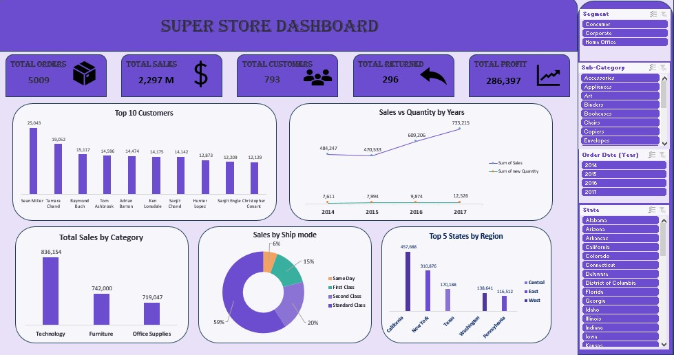

# Super Store Sales Dashboard | Excel

## Project Overview
This project analyzes retail sales data for a Super Store using Microsoft Excel (Power Query, Power Pivot, Pivot Tables, and Slicers) to understand sales performance, customer value, product categories, shipping behavior, returns, and geographic distribution.

The main goal is to transform raw order-level data into an interactive dashboard that helps decision-makers quickly monitor key sales KPIs and explore the business by segment, sub-category, year, and state.

## Dataset Description
The analysis is based on two source files:

### 1. `Sales_dataset.xlsx`
| Sheet | Rows | Description |
|---|---|---|
| Orders | 9,994 rows × 20 columns | Order lines (one row per product in an order) |
| Return | 296 rows | Order IDs that were returned |
| People | 4 rows | Regional managers (one per region) |

**Orders columns:** Row ID, Order ID, Order Date, Ship Date, Ship Mode, Customer ID, Customer Name, Segment, Location, State, Postal Code, Region, Product ID, Category, Sub-Category, Product Name, Sales, Quantity, Discount, Profit.

### 2. `Shipping_Cost.xlsx`
| Column | Description |
|---|---|
| State | US state (49 states) |
| Shipping Cost Per Unit | Shipping cost per unit for that state |

**Dataset scope:** orders from **January 2014 to December 2017**, covering **5,009 orders**, **793 customers**, **49 states**, **4 regions**, **3 customer segments**, **3 categories**, and **17 sub-categories**.

## Tools Used
- Microsoft Excel
- Power Query (data loading and cleaning)
- Power Pivot / Data Model (distinct count measures and table relationships)
- Pivot Tables
- Slicers
- Charts and Data Visualization

## Project Workflow

### 1. Data Understanding
- Reviewed the Orders, Return, People, and Shipping Cost tables and their structure.
- Identified the grain of the data (one row per product line in an order) and the key fields used for linking tables (Order ID, State, Region).

### 2. Data Cleaning & Preparation (Power Query)
- Loaded all tables into Power Query and then into the Excel Data Model.
- Checked for duplicate records: no duplicated rows or duplicated Row IDs were found.
- Checked for missing values: **14 rows had a missing `Quantity`**.
- Converted `Ship Date`, which was stored as numeric codes, into a proper date format.
- Handled the missing quantities by building a helper table (`Orders (2)`) with the **average unit price per product**, then calculating a **`new Quantity`** column from Sales, unit price, and Discount.

### 3. Data Analysis Using Pivot Tables
Created a set of Pivot Tables (in the `pv` sheet), each answering a specific business question:

| Question | Analysis |
|---|---|
| What are the total orders? | Distinct count of Order ID |
| What is the total sales? | Sum of Sales |
| What are the total customers? | Distinct count of Customer ID |
| What is the total return? | Distinct count of returned Order IDs |
| What is the total profit? | Sum of Profit |
| Sales by category | Sum of Sales by Category |
| Sales & quantity by year | Sum of Sales and `new Quantity` by Order Date (Year) |
| Most used ship mode | Sum of Sales by Ship Mode |
| Which states generate the most sales by region? | Top 5 States by Sales, split by Region |
| Top 10 customers | Top 10 Customer Names by Sales |

### 4. Dashboard Development
Organized the Pivot Tables into a single interactive dashboard containing:
- **5 KPI cards:** Total Orders, Total Sales, Total Customers, Total Returned, Total Profit.
- **5 charts:** Top 10 Customers, Sales vs Quantity by Years, Total Sales by Category, Sales by Ship Mode, Top 5 States by Region.
- **4 Slicers:** Segment, Sub-Category, Order Date (Year), and State, all connected to the dashboard so the user can filter every visual at once.

## Dashboard Preview

## Key Findings

- The dataset contains **5,009 orders** from **793 customers**.
- Total sales reached approximately **2.30 million** (2,297,201), with a total profit of **286,397** (about a 12.5% profit margin).
- **296 orders were returned**, representing about 5.9% of all orders.
- **Technology** is the top category by sales (836,154), followed by **Furniture** (742,000) and **Office Supplies** (719,047). The three categories are fairly balanced (about 36%, 32%, and 31% of sales).
- Yearly sales dipped slightly in 2015 (−2.8% vs. 2014), then grew strongly in 2016 (+29.5%) and 2017 (+20.4%), reaching **733,215** in 2017.
- **Standard Class** is the most-used shipping mode (59% of sales), followed by Second Class (20%), First Class (15%), and Same Day (6%).
- **California** leads all states in sales (457,688), followed by **New York** (310,876), **Texas** (170,188), **Washington** (138,641), and **Pennsylvania** (116,512). These five states together generate about 52% of total sales.
- The top 10 customers are led by **Sean Miller** (25,043) and **Tamara Chand** (19,052), and together account for about 6.7% of total sales (153,811).

*Note: The findings describe this dataset (2014–2017) and should not be interpreted as company-wide facts beyond its scope.*

## Data Notes
- Quantity figures in the "Sales vs Quantity by Years" chart use the calculated `new Quantity` column (38,005 units in total), while the original Quantity column sums to 37,795 units.
- The `Shipping Cost` table was loaded into the Data Model alongside the other tables, and it is not used in the current dashboard visuals.
- `Ship Date` is not used in any of the dashboard metrics.
- Monetary values are reported in the dataset's original units.

## Business Value

This project demonstrates how Excel can be used to:

- Monitor core sales KPIs (orders, sales, customers, returns, profit) in one view.
- Identify top-performing categories, states, and customers.
- Understand shipping-mode preferences and yearly sales trends.
- Let non-technical users explore the data interactively through slicers.
- Support data-driven decisions in sales and operations.

## Skills Demonstrated

- Data Cleaning & Preparation (Power Query)
- Data Modeling (Power Pivot / Data Model)
- Pivot Tables & Slicers
- KPI Reporting
- Data Visualization
- Dashboard Development
- Business Insights

## Project Files

- Sales_dataset.xlsx — Original dataset (Orders, Return, People sheets).
- Shipping_Cost.xlsx — Shipping cost per unit by state.
- Sales_Dashboard.xlsx — Excel workbook containing the cleaned data, Pivot Tables (`pv` sheet), and the completed dashboard.
- Sales_Dashboard.jpg — Image of the final dashboard.

## Conclusion

This project demonstrates the use of Microsoft Excel (Power Query, Power Pivot, Pivot Tables, and Slicers) to clean, model, and analyze retail sales data and present the results in an interactive dashboard.

It highlights how combining multiple data sources into one model can turn raw orders into clear, actionable business insights.
